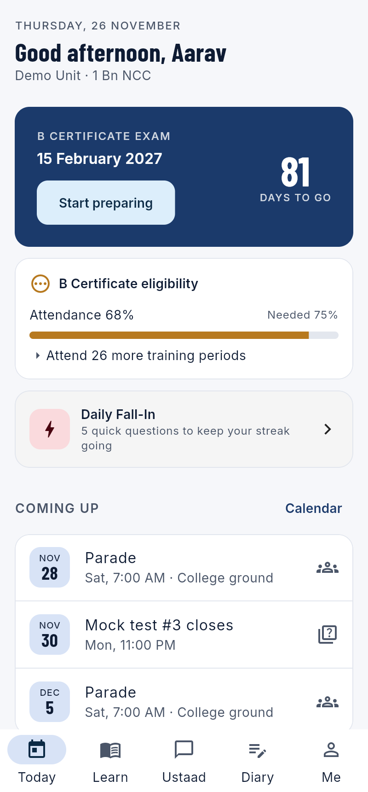
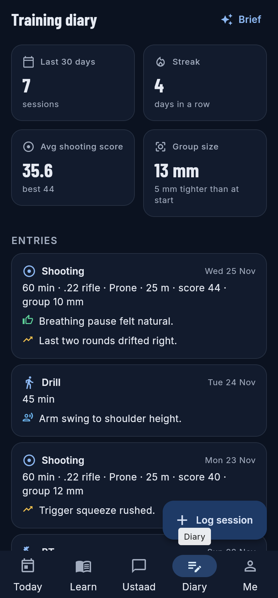
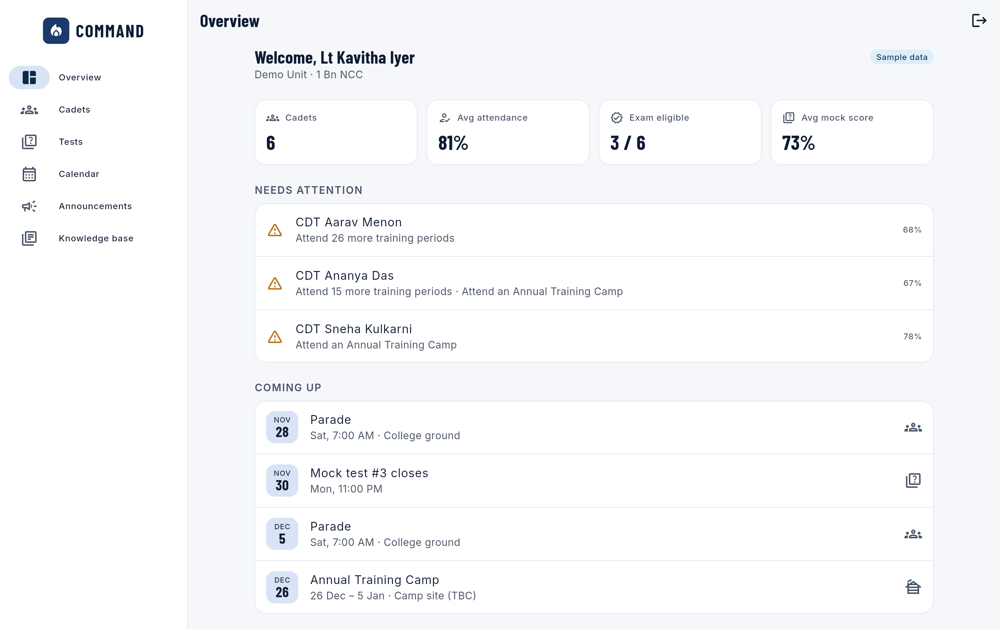

# Phoenix

The go-to app for NCC cadets, and the command center for their units.

Cadets prepare for the B and C Certificate exams and camps, keep a training
diary, and ask **Ustaad**, a study assistant that answers only from material
their unit has approved. ANOs and senior cadets run the unit: calendar,
announcements, tests, attendance, cadet records and the knowledge base.

| Cadet · light | Cadet · dark | Command Center |
| --- | --- | --- |
|  |  |  |

## Status

**Phase 0: foundation.** The app runs end to end in demo mode on sample data.
See [docs/PLAN.md](docs/PLAN.md) for the roadmap and
[docs/ARCHITECTURE.md](docs/ARCHITECTURE.md) for how it fits together.

| Area | State |
| --- | --- |
| Design system (light and dark, NCC palette, bundled fonts) | Done |
| Sign-in and roles (Cadet, Senior Cadet, ANO) with route guards | Done (demo); Supabase email sign-in wired |
| Cadet app: Today, Learn, practice and unit tests, Ustaad, Diary, Me | Screens done on sample data |
| Command Center: Overview, Cadets, Tests, Calendar, Announcements, Knowledge base | Screens done on sample data |
| B/C Certificate eligibility tracker | Done, unit-tested |
| Test marking with negative marking and weak-subject report | Done, unit-tested |
| Training diary with stats and brief preview | Done; AI briefs in Phase 2 |
| Supabase schema with row-level security | Done, checked on Postgres 16 |
| Précis ingestion pipeline (index, cited passages, draft MCQs) | Army JD/JW, Army SD/SW and Common SD/SW done: 1,575 passages, 232 MCQs; see [docs/CONTENT.md](docs/CONTENT.md) |
| Official subject lists in Learn (Army JD/JW, Army SD/SW, Common SD/SW) | Done (generated from the précis) |
| Keyword search for Ustaad (`search_chunks`) | Done in the schema |
| Ustaad answers with Claude | Phase 1 (needs an Anthropic key in Supabase) |

## Run it

Needs the Flutter SDK (3.50 or newer).

```bash
cd app
flutter pub get
flutter run            # demo mode: pick a role on the sign-in screen
```

To use a real backend, create a Supabase project, apply
`supabase/migrations/`, and pass its URL and publishable key:

```bash
flutter run --dart-define=SUPABASE_URL=https://YOUR-PROJECT.supabase.co --dart-define=SUPABASE_PUBLISHABLE_KEY=YOUR-KEY
```

## Checks

```bash
cd app
flutter analyze
flutter test
```

The database policies have their own check; see [supabase/README.md](supabase/README.md).
The ingestion pipeline: `python3 -m pytest tools/ingest/tests`.

## Repository layout

```
app/        Flutter app (Android, iOS, web) — cadet app and Command Center
supabase/   Database migrations and row-level-security checks
tools/      Précis ingestion pipeline (Python)
content/    Local précis sources and build output — git-ignored (DGNCC copyright)
docs/       Plan, architecture, content guide, screenshots
```
